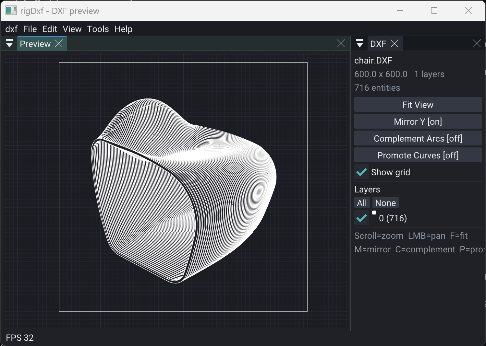

# rigDxf



ASCII DXF read/write as **typed POD entities** (paths, arcs, ellipses, splines), with a `ParsedPathDoc` / `CPaths` flatten lane for the plot pipeline.

Vendors [dxflib](third_party/dxflib/) (**GPL-2.0-or-later**). This pack is a GPL leaf.

Depends on **rigPlotComponent** (+ **rigComponent** for `CArc` / `CEllipse` / `CSpline`). Headless gate: `tools/dxf_smoke.cpp`.

## Supported on load

| Feature | Status |
|---------|--------|
| LINE | yes → Path |
| LWPOLYLINE / POLYLINE (+ bulge) | yes → Path + Arc |
| CIRCLE / ARC | yes → Ellipse / Arc |
| ELLIPSE (full + partial) | yes → Ellipse / Arc + rotation |
| SPLINE | yes → Spline |
| POINT | yes |
| INSERT / BLOCK | yes (expanded flat) |
| HATCH | boundaries only |
| SOLID / TRACE / 3DFACE | yes → Path |
| LAYER + ACI / color24 | yes |

## Skipped (counted in `doc.errors`)

TEXT, MTEXT, DIMENSION, XLINE, RAY, ATTRIB, IMAGE, LEADER, hatch **fill**, paper space.

## Curve promotion

Same policy as ofxDxf: **load is non-destructive** — no heuristic fitting runs automatically.

| Path | When | Default |
|------|------|---------|
| **Bulge → Arc** | During load | Always — LWPOLYLINE/POLYLINE bulge segments become typed `Arc` entities (straight runs stay `Path`) |
| **Faceted circle / arc** | `promoteCurves(doc, settings)` only | **Off** (`promoteFacetedCircles` / `promoteFacetedArcs` = false) |

`promoteBulgeArcCircles` / `promoteBulgeArcs` remain on the settings struct for API parity; after load they have nothing left to do because bulges are already arcs.

```cpp
rigkit::dxf::CurvePromotionSettings settings;
settings.promoteFacetedCircles = true; // opt in — hexagons stay polylines unless you ask
settings.promoteFacetedArcs = true;
auto result = rigkit::dxf::promoteCurves(doc, settings);
// result.circlesPromoted, result.arcsPromoted, result.entitiesExamined
```

The example’s **Faceted** layer is a 24-gon so **Promote Curves** in the sidebar has something to recover. Shortcut: `P`.

## API sketch

```cpp
rigkit::dxf::Document doc;
rigkit::dxf::loadFile("drawing.dxf", doc);
rigkit::dxf::flipY(doc);
rigkit::dxf::complementArcs(doc);
// optional: promoteCurves(doc, settings) — faceted recovery only; never implied by load

rigkit::plot::ParsedPathDoc parsed;
rigkit::dxf::flattenToParsed(doc, parsed); // plot lane

rigkit::dxf::save(doc, "out.dxf"); // flat R2000 ASCII
```

`loadFile(path, ParsedPathDoc&)` still works — load + flatten in one call.

[API/docs](https://rigkid.github.io/rigDxf/)
